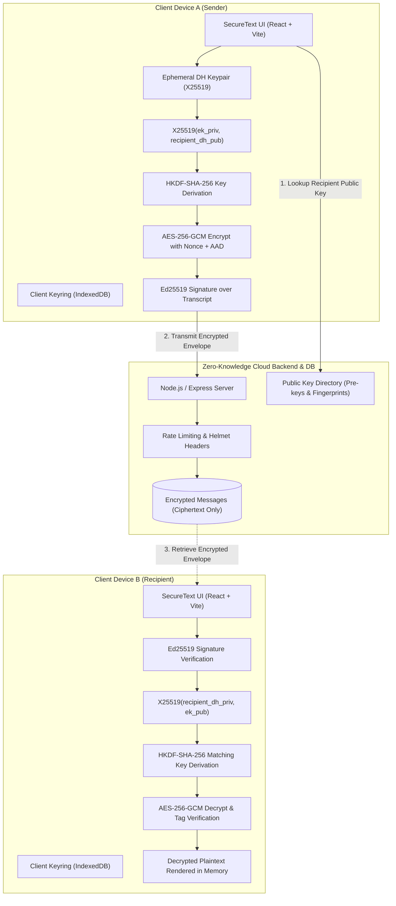

# SecureText: Secure Text Transfer Using Diffie–Hellman in a Cloud Environment

[](#cryptographic-architecture)
[](#zero-knowledge-cloud-architecture)
[](#automated-testing)
[](#research-evaluation--benchmarks)

**SecureText** is a full-stack, research-oriented, end-to-end encrypted cloud messaging system designed for academic evaluation and IEEE research paper publication.

---

## 1. System Architecture



---

## 2. Cryptographic Protocol Specification

1. **Key Generation (Client-Side Only)**:
   - **X25519 (RFC 7748)**: 256-bit Montgomery curve scalar keypair $(sk_{dh}, pk_{dh})$ for key agreement.
   - **Ed25519 (RFC 8032)**: 256-bit Edwards curve keypair $(sk_{sig}, pk_{sig})$ for digital signatures.
   - *Private keys never leave the client browser.*
2. **Key Agreement via X25519**:
   - Fresh ephemeral keypair $(ek_{priv}, ek_{pub})$ generated per message for **Forward Secrecy**.
   - Shared Secret: $SS = \text{X25519}(ek_{priv}, pk_{dh}^{recipient})$.
   - Ephemeral private key zeroized immediately after agreement.
3. **Key Derivation (RFC 5869 HKDF-SHA-256)**:
   - $\text{Salt} = \text{SHA-256}(ek_{pub} \parallel pk_{dh}^{recipient})$.
   - $\text{Info} = \text{"SecureText-v1-AES-GCM-MessageKey"}\parallel \text{senderId}\parallel \text{recipientId}\parallel \text{messageId}$.
   - Derives 256-bit symmetric encryption key $K_{msg}$.
4. **Authenticated Encryption (NIST SP 800-38D AES-256-GCM)**:
   - Unique 96-bit (12-byte) CSPRNG nonce per message.
   - Authenticated Additional Data (AAD) binds message metadata, timestamps, and routing identifiers.
   - 128-bit (16-byte) GHASH authentication tag ensures integrity.
5. **Identity Authentication & Non-Repudiation (Ed25519)**:
   - Transcript Hash: $\tau = \text{SHA-256}(\text{AAD} \parallel \text{Nonce} \parallel \text{Ciphertext} \parallel \text{Tag})$.
   - Signed by sender's identity key: $\sigma = \text{Ed25519-Sign}(sk_{sig}^{sender}, \tau)$.
6. **Recipient Verification & Decryption**:
   - Replay protection check against client sequence cache.
   - Ed25519 signature verification against sender's registered public key.
   - Reconstruction of shared secret and identical HKDF key.
   - AES-GCM tag verification; halts immediately if even 1 bit is tampered.

---

## 3. Technology Stack

- **Frontend**: React 19, Vite, TypeScript, React Router, Lucide Icons, Modern Responsive CSS.
- **Backend**: Node.js v24, Express, TypeScript, Zod Schema Validation, Helmet, Rate Limiter.
- **Cryptography**: `@noble/curves` (audited, pure zero-dependency X25519 & Ed25519), `@noble/ciphers` (AES-256-GCM), `@noble/hashes` (HKDF-SHA-256).
- **Database**: Dual-adapter architecture:
  - Local Development: High-speed, zero-config SQLite (`sql.js`).
  - Cloud Production: PostgreSQL / Supabase (`pg`).
- **Testing & Benchmarks**: Vitest, Supertest, Custom Microbenchmark Suite.

---

## 4. Quick Start Guide

### Prerequisites
- Node.js >= 18 (Tested on Node.js v24.2.0)
- npm >= 9

### Installation
Clone the repository and install all dependencies:
```bash
npm install
```

### Build Workspaces
Compile the shared protocol definitions, backend, and frontend:
```bash
npm run build
```

### Start Development Servers
Start backend API (port 5000):
```bash
npm run dev:backend
```
In a second terminal, start frontend (port 5173):
```bash
npm run dev:frontend
```
Open your browser at: **`http://localhost:5173`**

---

## 5. Pre-Seeded Research Demo Accounts

For university evaluation and supervisor demonstrations, two pre-seeded accounts are provided:

| Account | Email | Password | Role |
| :--- | :--- | :--- | :--- |
| **Alice Johnson** | `alice@securetext.local` | `AlicePass123!` | Sender / Peer A |
| **Bob Martinez** | `bob@securetext.local` | `BobPass123!` | Recipient / Peer B |

*You can also freely register new custom user identities at `/register`.*

---

## 6. Automated Testing & Verification

Run the full automated test suite (17 passing tests):
```bash
npm run test
```

### Test Coverage:
- `src/tests/crypto.test.ts`:
  - 32-byte independent keypair generation for X25519 and Ed25519.
  - Symmetrical shared secret agreement: $\text{X25519}(sk_A, pk_B) == \text{X25519}(sk_B, pk_A)$.
  - HKDF-SHA-256 symmetric key derivation.
  - AES-256-GCM AEAD encryption and decryption roundtrip.
  - Ed25519 envelope signature and verification.
- `src/tests/security.test.ts`:
  - Single-bit ciphertext corruption rejection (`invalid ghash tag`).
  - Authentication tag forgery rejection.
  - Tampered Authenticated Additional Data (AAD) metadata rejection.
  - Forged Ed25519 signature rejection.
  - Rogue self-signed public-key registration bundle rejection.
- `src/tests/api.test.ts`:
  - Health check endpoint.
  - Registration with bcrypt password hashing.
  - Session verification (/api/auth/me).
  - Public key registration with self-signature verification.
  - **Zero-Knowledge Policy Enforcement**: Plaintext submission is rejected with HTTP 400.
  - Encrypted envelope persistence in cloud storage.
  - Cloud vault ciphertext inspection.

---

## 7. Research Evaluation & Experimental Results

Run the reproducible research benchmark suite:
```bash
npm run benchmark
```

Raw measurement data is exported to:
- `benchmarks/results.csv` (all individual iteration rows)
- `benchmarks/benchmark_report.md` (formatted markdown tables for IEEE paper)

### Experimental Latency Breakdown (Hardware: 13th Gen Intel Core i9-13900H):

| Payload Size | X25519 KeyGen | X25519 DH | HKDF-SHA256 | AES-GCM Enc | AES-GCM Dec | Ed25519 Sign | Ed25519 Ver | Total Crypto Latency |
| :--- | :--- | :--- | :--- | :--- | :--- | :--- | :--- | :--- |
| **100 Bytes** | 2.46 ms | 2.42 ms | 0.22 ms | 0.22 ms | 0.18 ms | 1.46 ms | 3.76 ms | **10.55 ms** |
| **1 KB** | 2.02 ms | 2.18 ms | 0.12 ms | 0.27 ms | 0.30 ms | 0.86 ms | 3.39 ms | **9.40 ms** |
| **10 KB** | 2.65 ms | 2.70 ms | 0.14 ms | 0.97 ms | 0.86 ms | 1.30 ms | 3.88 ms | **12.31 ms** |
| **100 KB** | 2.87 ms | 2.60 ms | 0.13 ms | 4.53 ms | 4.64 ms | 1.19 ms | 3.89 ms | **19.68 ms** |

---

## 8. Repository Structure

```
Secure text project/
├── backend/
│   ├── src/
│   │   ├── controllers/      # Auth, Keys, Messages, Security
│   │   ├── crypto/           # Verification & Key Bundles
│   │   ├── database/         # SQLite / PostgreSQL DB Adapters & Seeder
│   │   ├── middleware/       # JWT Auth & Rate Limiter
│   │   ├── routes/           # REST API Route Registrations
│   │   ├── tests/            # Automated Unit, Security & Integration Tests
│   │   ├── benchmarks/       # Microbenchmark Runner
│   │   └── index.ts          # Express Server Setup
│   └── package.json
├── frontend/
│   ├── src/
│   │   ├── components/       # Sidebar, Header, Modals, Inspectors
│   │   ├── context/          # Auth & Keyring Provider
│   │   ├── crypto/           # Client X25519, HKDF, AES-GCM, Ed25519
│   │   │   └── educational/  # Finite-Field DH, RSA, Playfair Labs
│   │   ├── pages/            # 10 Responsive Application Views
│   │   ├── services/         # REST API Client
│   │   └── styles/           # Cybersecurity Styling
│   └── package.json
├── shared/
│   ├── index.ts              # Canonical Protocols, Envelopes & Types
│   └── package.json
├── database/
│   └── schema.sql            # Dual SQLite / PostgreSQL Schema
├── docs/
│   ├── architecture.md       # Full System Architecture
│   ├── threat-model.md       # Adversary & Security Assumptions
│   ├── cryptographic-protocol.md # Exact Mathematical Formulas
│   ├── api-reference.md      # REST API Specification
│   ├── testing.md            # Test Suite Documentation
│   ├── demonstration-script.md # Presentation & Viva Script
│   └── postman_collection.json # Complete Postman API Collection
├── benchmarks/
│   ├── results.csv           # Raw Trial Measurements
│   └── benchmark_report.md   # IEEE-Style Evaluation Findings
├── .env.example
├── .gitignore
└── README.md
```

---

## 9. Limitations & Future Research Directions

1. **Traffic Analysis & Metadata**: The cloud server records routing metadata (sender ID, recipient ID, message length, and upload timestamp). Future research can integrate fixed-length payload padding and onion routing (e.g., Mixnets) to mask traffic patterns.
2. **Public Key Directory Trust**: Key bundles are currently authenticated via Ed25519 self-signatures and verified out-of-band using 60-digit safety numbers. A future iteration can incorporate an append-only verifiable transparency log (such as CONIKS or Certificate Transparency) for automated server auditing.
3. **Multi-Device Synchronization**: The current prototype demonstrates a single keypair per user profile. Extending the protocol to support multiple registered client devices with Signal-style Double Ratchet and pre-key bundles (X3DH) represents a valuable research extension.
# Secure-Text-Transfer-Using-Diffie-Hellman-Key-Exchange-in-a-Cloud-Environment

# Secure-Text-Transfer-Using-Diffie-Hellman-Key-Exchange-in-a-Cloud-Environment

