# SecureText System Architecture

## 1. Executive Summary
**SecureText** is an end-to-end encrypted messaging application tailored for cloud deployments and evaluated for academic research. It demonstrates how modern asymmetric cryptography (Curve25519) can be coupled with key derivation functions (HKDF-SHA-256), authenticated symmetric ciphers (AES-256-GCM), and digital signatures (Ed25519) to achieve confidentiality, integrity, authenticity, and forward secrecy in zero-knowledge cloud architectures.

---

## 2. Structural Layers

```mermaid
flowchart TB
    subgraph UI_Layer["Presentation Layer (React 19 + TypeScript + Vite)"]
        Nav["Cybersecurity Navigation & Sidebar"]
        Dashboard["Messaging & Conversation Dashboard"]
        Inspector["Message Security Details Inspector"]
        SecCenter["Security Center & Key Management"]
        CloudDash["Cloud Storage & Audit Vault"]
        EduModules["Educational Crypto Modules (DH, RSA, Playfair)"]
    end

    subgraph Crypto_Engine["Client Cryptographic Engine (Browser Sandbox)"]
        KeyStore["Encrypted Keyring (IndexedDB / WebCrypto)"]
        X25519_Mod["X25519 Ephemeral-Static Agreement"]
        HKDF_Mod["HKDF-SHA-256 Expansion"]
        AES_GCM_Mod["AES-256-GCM AEAD Processor"]
        Ed25519_Mod["Ed25519 Identity Signer & Verifier"]
    end

    subgraph Network_Layer["Secure Transport (HTTPS / REST)"]
        JWT_Auth["Stateless JWT / HttpOnly Session"]
        PayloadEnvelope["Canonical JSON Ciphertext Envelopes"]
    end

    subgraph Backend_Layer["Cloud Application Server (Node.js + Express)"]
        RateLimiter["Rate Limiting & Threat Shield (Helmet)"]
        Validation["Zod Request Schema Validation"]
        Controllers["Auth, Key Directory & Message Routing"]
        AuditService["Security Event Audit Logger"]
    end

    subgraph Data_Layer["Zero-Knowledge Storage (PostgreSQL / SQLite)"]
        DB_Users[("User Identity DB")]
        DB_Keys[("Public Key Directory & Signatures")]
        DB_Ciphertext[("Encrypted Envelopes (No Plaintext)")]
        DB_Audit[("Security Events & Replay Logs")]
    end

    UI_Layer --> Crypto_Engine
    Crypto_Engine --> Network_Layer
    Network_Layer --> Backend_Layer
    Backend_Layer --> Data_Layer
```

---

## 3. Cryptographic State Transition & Data Flow

### A. Message Dispatch (Client A $\to$ Cloud)
1. **User Action**: Alice drafts plaintext $P$ destined for Bob ($uid_B$).
2. **Directory Lookup**: Client fetches Bob's verified identity bundle: $(pk_{dh}^B, pk_{sig}^B, \text{fingerprint}_B)$.
3. **Key Agreement**: Alice generates ephemeral X25519 keypair $(sk_{eph}^A, pk_{eph}^A)$ and computes:
   $$SS = \text{X25519}(sk_{eph}^A, pk_{dh}^B)$$
4. **Key Derivation**: Derive symmetric key $K_{msg} = \text{HKDF-SHA-256}(SS, \text{Salt}, \text{Info})$.
5. **Authenticated Encryption**: Generate random 96-bit nonce $N$, compile canonical AAD, and compute:
   $$(C, T) = \text{AES-256-GCM-Encrypt}(K_{msg}, N, P, \text{AAD})$$
6. **Digital Signing**: Compile transcript $\tau = \text{SHA-256}(\text{AAD} \parallel N \parallel C \parallel T)$ and sign:
   $$\sigma = \text{Ed25519-Sign}(sk_{sig}^A, \tau)$$
7. **Cloud Upload**: Alice posts envelope $\{ \text{AAD}, pk_{eph}^A, N, C, T, \sigma \}$ to `/api/messages`.
8. **Memory Sanitization**: $sk_{eph}^A, SS, K_{msg}, P$ are cleared from volatile memory.

### B. Message Retrieval (Cloud $\to$ Client B)
1. **Cloud Fetch**: Bob authenticates and requests pending envelopes from `/api/messages`.
2. **Signature Verification**: Bob validates Alice's signature $\sigma$ against Alice's registered Ed25519 key.
3. **Key Agreement**: Bob reconstructs shared secret:
   $$SS = \text{X25519}(sk_{dh}^B, pk_{eph}^A)$$
4. **Key Derivation**: Derive matching $K_{msg} = \text{HKDF-SHA-256}(SS, \text{Salt}, \text{Info})$.
5. **Decryption & Tag Check**: Bob executes AES-GCM decryption with $(K_{msg}, N, C, \text{AAD}, T)$. If tag verification fails, message is marked as tampered and discarded.
6. **Replay Validation**: Bob verifies monotonic message timestamp against local sequence cache.
7. **Presentation**: Decrypted plaintext $P$ is rendered directly to the isolated UI view.

---

## 4. Zero-Knowledge Cloud Storage Invariants
- The database **NEVER** stores unencrypted message bodies.
- The server **NEVER** receives, possesses, or caches private keys ($sk_{dh}, sk_{sig}$) or message keys ($K_{msg}$).
- The server operates purely as an authenticated message relay and public-key registry.
